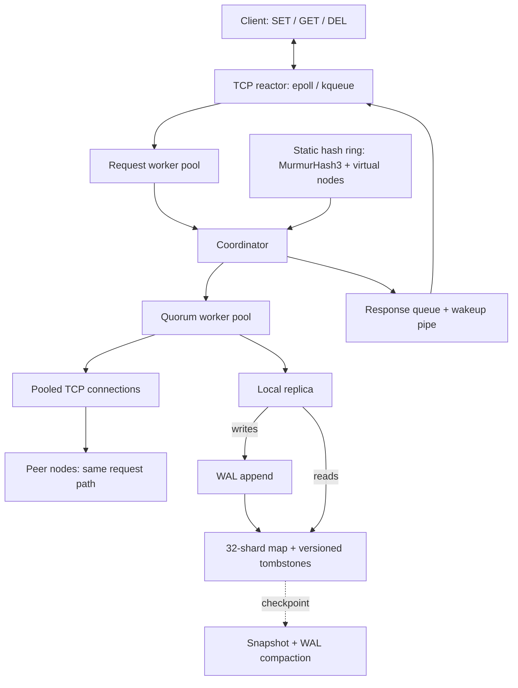
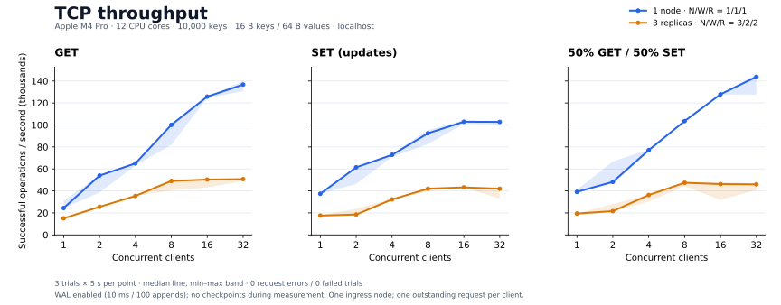
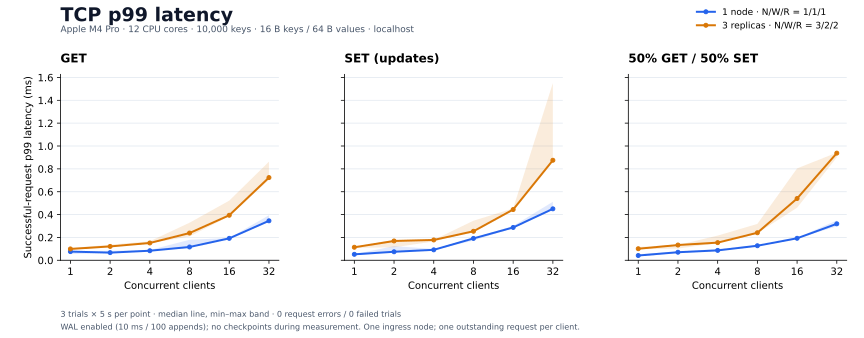

# distributed-kv

A leaderless, in-memory key-value store in C++20, with static consistent hashing, quorum-based replication, last-write-wins conflict resolution, and a WAL plus snapshot storage layer.

Built directly on POSIX sockets and standard C++ concurrency primitives. The implementation covers the path from socket readiness to replica coordination, local persistence, and recovery:

- **Networking:** an `epoll`/`kqueue` reactor, request workers, pooled replica connections, and asynchronous response delivery.
- **Replication:** configurable read/write thresholds, versioned tombstones, read repair, and heartbeat-triggered hinted handoff.
- **Recovery:** CRC32-protected WAL records, snapshot sequence tracking, and deterministic regressions for torn logs and checkpoint races.

## Guarantees and semantics

`N` is the number of replicas per key; `W` and `R` are the required write and read replies. Defaults are **N=3, W=2, R=2**.

| Area | Implemented behavior |
| --- | --- |
| Consistency | Replicas retain the greatest `(timestamp_ms, node_id)` version. Reads return the greatest version among their selected responders, including tombstones. There is no linearizability, causal consistency, or session read-your-writes guarantee. |
| Write acknowledgement | Writes target the key's `N` replicas, **wait for all attempts to finish**, then succeed if at least `W` acknowledge. A replica can acknowledge an older version without replacing its current value. |
| Read quorum | Reads contact the ring's **first `R` replicas** and require `R` valid replies. They do not try another replica when a selected one is unavailable. |
| Durability | Replica mutations append to the WAL before updating memory. `fsync` is batched: by default a 10 ms timer and a 100-append threshold. An acknowledgement does **not** promise an `fsync` on any replica, and the timer is not a hard loss bound. |
| Retries | A failed or timed-out write may have taken effect on some replicas. There is no rollback, client request deduplication, or exactly-once guarantee; a retry receives a new version. |
| Convergence | Read repair updates stale responding replicas. Hints are replayed when a peer transitions from DOWN to UP. Neither mechanism guarantees delivery under every failure pattern. |

Startup requires `W + R > N`. This gives overlapping replica sets under a valid configuration; it is not consensus. Timestamps increase within a coordinator process, but are neither recovered as a clock nor advanced from received versions. Clock skew and restarts therefore affect conflict resolution.

## Architecture



**Write path.** Any contacted node coordinates the request. It selects `N` distinct physical replicas clockwise on the ring, assigns one version, and sends `RSET` or `RDEL`. Each replica appends the mutation to its local WAL and applies it if its version is newer. Failed remote attempts create hints; hints do not count toward `W` and no substitute replicas are used.

**Read path.** The coordinator queries its selected `R` replicas, compares values and tombstones by version, and returns the winner. Stale or missing copies among those responders are repaired asynchronously. Local repairs use the WAL-backed mutation path too.

The default three-node cluster stores every key on all three nodes. Distributing different replica sets across the cluster requires more physical nodes than `N`. Membership is configured at startup; failure detection does not change placement or migrate data.

### Design tradeoffs

- **Leaderless replication:** any node can coordinate, with no election or replicated consensus log. Version ordering resolves conflicts, but does not establish real-time or causal ordering.
- **Hash partitioning:** virtual nodes distribute key ownership without a central routing service. There are no ordered range scans or online rebalancing.
- **Map plus WAL:** reads use a sharded `unordered_map` with reader-writer locks; the full working set lives in memory. Tombstones prevent older values from winning over newer deletions, but are not garbage-collected.
- **Checkpoint ordering:** one node-wide mutation lock spans WAL append, memory application, and checkpointing. This prevents compaction from discarding an unapplied record, at the cost of serializing WAL-backed writes and pausing them during snapshots.
- **Two concurrency layers:** the reactor owns sockets; request workers wait on a separate replica fan-out pool. Replica RPCs use blocking pooled connections, so slow peers occupy workers and affect latency.

Implementation entry points: [TCP server](src/network/tcp_server.cpp), [coordinator](src/cluster/coordinator.cpp), [hash ring](src/cluster/hash_ring.cpp), [storage engine](src/storage/storage_engine.cpp), [WAL](src/storage/wal.cpp), and [snapshots](src/storage/snapshot.cpp).

## Failure behavior

| Scenario | What happens |
| --- | --- |
| One replica is unavailable, with N=3/W=2/R=2 | Writes can succeed with two acknowledgements. Reads fail for keys whose selected pair includes the unavailable replica, even if another live replica holds the value. There is no general “survives any one failure” availability guarantee. |
| A partition prevents the required replies | The operation returns `QUORUM_FAILED`; a failed write can still leave partial effects. There is no leader to elect and no rollback. |
| A peer is slow | Writes wait for all replica attempts, rather than returning at the first `W` acknowledgements. Slow disk operations and checkpoints can also stall local mutations. |
| A peer returns after being marked DOWN | The rejoin callback attempts hinted handoff. Short outages that never reach DOWN, failed replay, and concurrent hint updates remain limitations. |
| A process restarts | It loads the highest-numbered snapshot and replays subsequent valid WAL records. Recovery truncates an invalid WAL suffix before allowing new appends. |

**Persistence boundary:** this is not a power-loss-safe storage engine. Snapshot files are written directly to their final names without an atomic publication protocol, and some write/`fsync` results are unchecked. An interrupted newest snapshot can also compromise process-restart recovery after earlier WAL compaction. The tested checkpoint-ordering fix does not solve these separate I/O failure cases.

## Quickstart

Requires Linux or macOS, a C++20 compiler, CMake **3.16+**, Git, and Python 3 for the readiness check and process tests. CMake fetches GoogleTest 1.14 during configuration; the server uses no external networking framework. Run from the repository root.

```bash
cmake -S . -B build/release -DCMAKE_BUILD_TYPE=Release
cmake --build build/release --parallel 4
```

Paste this block to start all three nodes using [the example configuration](cluster.conf.example). Ports **7001–7003 must be free**. Each node gets its own persistence directories; the launcher prints their location and preserves logs after shutdown. Use **Ctrl-C** to stop the cluster.

```bash
bash <<'SH'
set -eu
dkv_run=$(mktemp -d "${TMPDIR:-/tmp}/dkv.XXXXXX")
dkv_pids=()
cleanup() {
  for pid in "${dkv_pids[@]}"; do kill "$pid" 2>/dev/null || true; done
  for pid in "${dkv_pids[@]}"; do wait "$pid" 2>/dev/null || true; done
}
trap cleanup EXIT
trap 'exit 130' INT
trap 'exit 143' TERM
for i in 1 2 3; do
  mkdir -p "$dkv_run/node$i"
  ./build/release/bin/dkv_node --node-id "$i" --port "$((7000 + i))" \
    --cluster-conf cluster.conf.example \
    --replication-factor 3 --write-quorum 2 --read-quorum 2 \
    --wal-dir "$dkv_run/node$i/wal" \
    --snapshot-dir "$dkv_run/node$i/snapshots" \
    --hints-dir "$dkv_run/node$i/hints" \
    >"$dkv_run/node$i/node.log" 2>&1 &
  dkv_pids+=("$!")
done
printf 'Data and logs: %s\n' "$dkv_run"
python3 - <<'PY'
import socket, time
for port in (7001, 7002, 7003):
    deadline = time.monotonic() + 10
    while time.monotonic() < deadline:
        try:
            with socket.create_connection(("127.0.0.1", port), timeout=1) as sock:
                sock.sendall(b"PING\n")
                with sock.makefile("rb") as stream:
                    if stream.readline() == b"+PONG\n":
                        break
        except OSError:
            pass
        time.sleep(0.1)
    else:
        raise SystemExit(f"Node on port {port} did not become ready; inspect logs")
print("Three nodes ready. Open the CLI in another terminal; Ctrl-C stops the cluster.")
PY
for pid in "${dkv_pids[@]}"; do kill -0 "$pid"; done
wait
SH
```

In another terminal, from the repository root:

```bash
./build/release/bin/dkv_cli --host 127.0.0.1 --port 7001
```

```text
dkv> SET greeting "hello world"
OK
dkv> GET greeting
"hello world"
dkv> DEL greeting
OK
dkv> GET greeting
(nil)
dkv> QUIT
Bye.
```

Use `--help` on `dkv_node` for configuration options. Keep the same ring configuration on every node and use distinct node IDs and data directories. `--fsync-interval-ms 0` disables the timer; it does **not** enable synchronous acknowledgement.

### API

| Operation | CLI syntax | Purpose |
| --- | --- | --- |
| Put | `SET <key> <value>` | Write a versioned value |
| Get | `GET <key>` | Read the highest version from the selected read quorum |
| Delete | `DEL <key>` | Write a versioned tombstone |
| Health | `PING` | Check that a node responds; does not check cluster quorum |

The CLI formats the [wire protocol](src/network/protocol.cpp): for example, `SET 5 hello 5 world\n` and `GET 5 hello\n`. Frames are newline-delimited despite their inline byte lengths, so embedded newlines are unsupported. Use one outstanding request per connection; pipelined execution and reply ordering are not guaranteed. CAS, transactions, range scans, and TTLs are not implemented.

## Correctness and recovery evidence

The current suite contains **192 CTest cases** (including three benchmark statistics regressions) and **9 separate server-process scenarios**, plus the benchmark checks below. The [2026-10-16 correctness audit](tests/correctness_audit.txt) records the earlier 189-case suite's before/after failures and passing native Debug, native UBSan, Linux ASan/UBSan, and Linux TSan runs. Those are dated audit results, not a claim of continuous CI coverage.

The most useful tests exercise boundaries ordinary happy-path tests miss:

- [Deterministic checkpoint race](tests/integration/test_recovery_boundaries.cpp): syscall and lock gates force the WAL-append/application interleaving that previously discarded an unapplied record. A second regression checks repair draining before WAL destruction.
- [WAL recovery](tests/unit/test_wal.cpp): every truncation point in a versioned record, append after a torn tail followed by a second recovery, malformed lengths, and preservation of version origins.
- [Real-process scenarios](tests/integration/test_correctness.py): two restarts after compaction, tombstone repair, insufficient read quorum, malformed replica replies, and hinted deletion delivery to a killed/restarted replica. A seeded Python LWW reference model checks reordered and duplicated replica mutations; it explicitly syncs the WAL before killing processes.

Run both suites; CTest does not invoke the Python scenarios:

```bash
(cd build/release && ctest --parallel 1 --timeout 30 --output-on-failure)
python3 tests/integration/test_correctness.py \
  --binary build/release/bin/dkv_node --artifacts build/correctness-evidence
```

For a focused failure/recovery demonstration:

```bash
python3 tests/integration/test_correctness.py \
  --binary build/release/bin/dkv_node --artifacts build/handoff-demo \
  Correctness.test_hinted_delete_reaches_restarted_replica
```

This starts its own cluster, kills a replica, deletes a key, waits for DOWN detection, restarts the replica, and verifies that the deletion arrives. Logs and persistence files are retained. These regressions do not constitute a linearizability check or exhaustive partition testing.

## Performance

These are **local TCP measurements**, with the client and all node processes sharing one Apple M4 Pro (12 cores, 24 GiB RAM, macOS 26.5.1, APFS). The binaries were built with Apple Clang 17 in Release mode (`-O3 -DNDEBUG`).





Each point is the **median of three five-second trials**; shaded bands show the full min–max range, not confidence intervals. All **108 trials completed with zero request errors**, covering 31,833,969 validated requests.

For a common comparison point, the medians at **16 concurrent clients** were:

| Workload | One node: ops/s | Three replicas: ops/s | One node: p99 | Three replicas: p99 |
| --- | ---: | ---: | ---: | ---: |
| GET | 125,825 | 50,336 | 0.192 ms | 0.394 ms |
| SET (updates) | 102,965 | 43,202 | 0.287 ms | 0.444 ms |
| 50% GET / 50% SET | 127,915 | 46,185 | 0.192 ms | 0.540 ms |

**What the curves show:** the three-replica configuration gains little throughput beyond roughly 8–16 clients while p99 continues to rise. This compares complete configurations—including replica RPCs, extra WAL writes, and worker scheduling—not an isolated network or replication cost. CPU and queue profiling would be needed to attribute the bottleneck.

**Methodology.** Each trial starts a fresh cluster, preloads 10,000 keys, and performs 500 warmup operations per client before timing. Keys are 16 bytes, values are 64 bytes, and SET updates existing keys. Requests are pre-generated and issued sequentially over persistent connections, with all clients targeting node 1. The configurations are N/W/R=1/1/1 and 3/2/2, with four request workers per node. WAL synchronization uses the default 10 ms timer and 100-append threshold; the snapshot interval is raised to one billion mutations to keep checkpoints outside this baseline. Trial order is shuffled with seed 1729.

The [TCP harness](bench/bench_cluster.cpp) validates responses and counts successful requests for throughput. Latencies use a monotonic clock and nearest-rank percentiles over successful requests; errors and failed preparation are reported separately. This is a closed-loop, small-working-set benchmark on a shared development machine. It does not establish arrival-rate SLAs, power-loss durability, multi-machine scaling, or snapshot overhead.

[Raw trial results](benchmarks/results/2026-10-27/trials.jsonl), [CSV](benchmarks/results/2026-10-27/summary.csv), [hardware/build metadata and source hashes](benchmarks/results/2026-10-27/metadata.json), and [per-trial logs](benchmarks/results/2026-10-27/trial-logs.tar.gz) accompany the figures.

<details>
<summary>Reproduce the measurements and plots</summary>

Build the Release binaries as above, then run the matrix. The runner starts and stops its own clusters, keeps every trial, and requires a fresh output directory:

```bash
python3 -B scripts/run_benchmarks.py \
  --binary-dir build/release/bin --output build/benchmark-run \
  --nodes 1,3 --clients 1,2,4,8,16,32 --workloads get,set,mixed \
  --repeats 3 --seconds 5 --keys 10000 --warmup-ops 500 --seed 1729
```

Plot generation needs Python 3.11+ and Matplotlib; the runner itself uses only the standard library:

```bash
python3 -m venv build/plot-venv
build/plot-venv/bin/python -m pip install -r bench/requirements.txt
build/plot-venv/bin/python scripts/plot_benchmarks.py \
  --input build/benchmark-run --output build/benchmark-plots
```

To regenerate the published figures without rerunning the benchmarks, use `--input benchmarks/results/2026-10-27`.

Benchmark-specific regressions cover percentile boundaries, refused connections, server errors, incorrect values, disconnect accounting, preparation failure, operation-count remainders, and runner cleanup:

```bash
python3 -B tests/integration/test_benchmark.py --binary build/release/bin/bench_cluster
python3 -B tests/integration/test_benchmark_runner.py --binary-dir build/release/bin
python3 -B tests/integration/test_benchmark_plots.py
```

The separate [storage microbenchmark](bench/bench_storage.cpp) excludes TCP, WAL, and replication. Its percentile and rejected-write accounting still need correction; its output is not used in these figures.

</details>

## Limitations and next steps

This is a systems engineering project for trusted networks. Client and internal replica commands share an unauthenticated listener; there is no TLS or access control.

The next priorities are atomic snapshot publication and checked persistence I/O; connection-generation tracking and ordered replies; bounded request queues and overload handling; and reliable hint retry/replay under concurrent updates. Multi-node ingress saturation, partial replica sends, clock rollback/restart collisions, and disk-full behavior need targeted fault tests.

Online membership changes, data migration, global anti-entropy, tombstone collection, and consensus are not implemented. The working set and tombstones must fit in RAM. Mixed-version operation with older WAL/protocol formats is not supported; see the [audit's compatibility notes](tests/correctness_audit.txt).

## License

MIT
