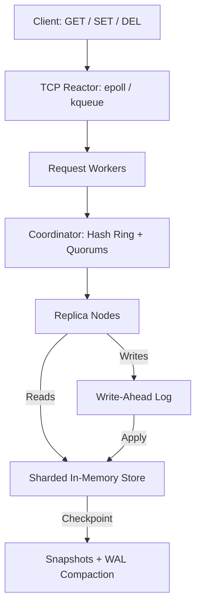

# distributed-kv

A **leaderless distributed key-value store** built in C++20 with consistent hashing, quorum-based replication, and write-ahead logging. Implemented using POSIX sockets and standard C++ concurrency primitives, without a networking framework.

## Features

- **Consistent hashing:** MurmurHash3 and virtual nodes determine key placement across the cluster.
- **Quorum replication:** Configurable replication factor (`N`), write quorum (`W`), and read quorum (`R`).
- **Conflict resolution:** Last-write-wins versioning with tombstones for deletions.
- **Replica recovery:** Read repair, heartbeat-based failure detection, and hinted handoff.
- **Persistent storage:** CRC32-protected write-ahead logs, periodic snapshots, and WAL compaction.
- **Concurrent networking:** An `epoll`/`kqueue` reactor, worker pools, and pooled TCP connections.

## Architecture



Any node can coordinate a request. The coordinator uses a consistent hash ring to select replicas, then collects the required responses. Reads select the newest version among the queried replicas and trigger asynchronous repair of stale copies; writes append to each participating replica's WAL before updating its in-memory state.

The default configuration uses **N=3, W=2, R=2**. Values are ordered by `(timestamp_ms, node_id)`, and deletes are represented by versioned tombstones.

## Getting Started

**Requirements:** Linux or macOS, a C++20 compiler, and CMake 3.16+.

### Build

```bash
cmake -S . -B build/release -DCMAKE_BUILD_TYPE=Release
cmake --build build/release --parallel
```

### Run a three-node cluster

From the repository root:

```bash
mkdir -p build/nodes

for i in 1 2 3; do
  mkdir -p "build/nodes/$i"
  ./build/release/bin/dkv_node \
    --node-id "$i" --port "$((7000 + i))" \
    --cluster-conf cluster.conf.example \
    --wal-dir "build/nodes/$i/wal" \
    --snapshot-dir "build/nodes/$i/snapshots" \
    --hints-dir "build/nodes/$i/hints" \
    > "build/nodes/$i/server.log" 2>&1 &
done
```

Connect using the CLI in another terminal:

```bash
./build/release/bin/dkv_cli --host 127.0.0.1 --port 7001
```

```text
dkv> SET greeting "hello world"
OK
dkv> GET greeting
"hello world"
dkv> DEL greeting
OK
dkv> GET greeting
(nil)
```

The CLI also supports `PING`. Run `./build/release/bin/dkv_node --help` for configuration options.

## Performance

Local TCP benchmarks compare a single-node setup (`N=1, W=1, R=1`) with a three-replica cluster (`N=3, W=2, R=2`). The client and servers ran on the same Apple M4 Pro machine.

**Throughput vs. concurrent clients**


**p99 latency vs. concurrent clients**


At **16 concurrent clients**, the median results were:

| Workload | Single node | Three replicas | Single-node p99 | Three-replica p99 |
| --- | ---: | ---: | ---: | ---: |
| GET | 125,825 ops/s | 50,336 ops/s | 0.192 ms | 0.394 ms |
| SET | 102,965 ops/s | 43,202 ops/s | 0.287 ms | 0.444 ms |
| 50% GET / 50% SET | 127,915 ops/s | 46,185 ops/s | 0.192 ms | 0.540 ms |

Each plotted point is the median of three five-second trials using 10,000 preloaded keys, 16-byte keys, and 64-byte values. Replication adds work through replica RPCs and additional WAL writes; the three-replica configuration levels off around 8–16 concurrent clients in this benchmark.

These are **single-machine measurements**, not evidence of multi-host scaling. See the [raw results](benchmarks/results/2026-10-27/summary.csv) and [benchmark runner](scripts/run_benchmarks.py) for details.

## Testing

Unit and integration tests cover quorum behavior, replica recovery, WAL corruption, snapshot boundaries, and concurrent operations.

```bash
(cd build/release && ctest --output-on-failure)
python3 tests/integration/test_correctness.py \
  --binary build/release/bin/dkv_node --artifacts build/correctness-evidence
```

## Limitations

- **Consistency:** Quorums and last-write-wins do not provide linearizability or consensus. Reads contact a fixed set of replicas, so some reads may fail during an outage even when another replica has the value.
- **Durability:** WAL writes are acknowledged before guaranteed `fsync`, and snapshot publication is not fully power-loss safe.
- **Cluster management:** Membership is static; online rebalancing, migration, and full anti-entropy are not implemented.
- **Security:** There is no authentication or TLS. The system is intended for trusted environments.

## License

MIT
